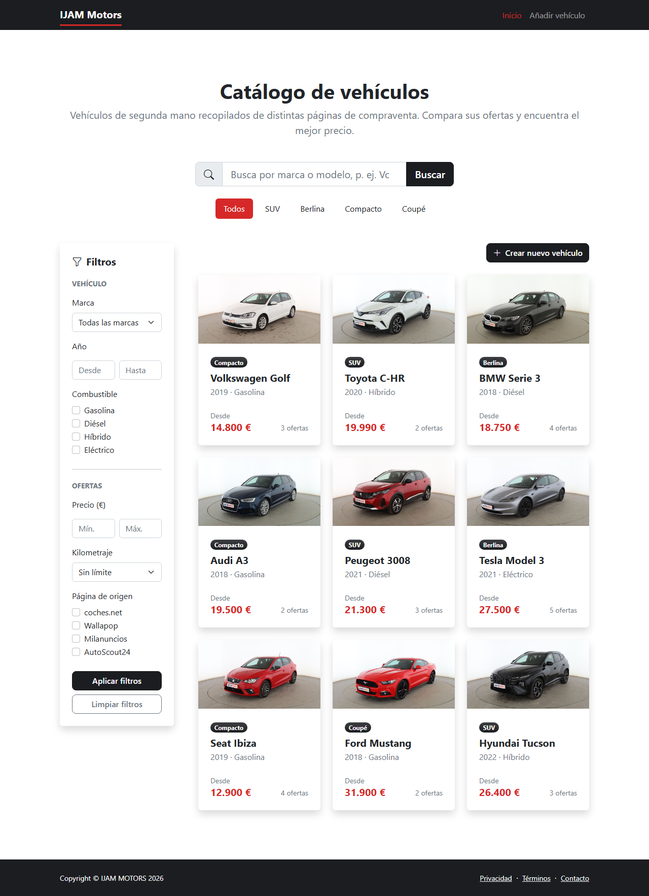
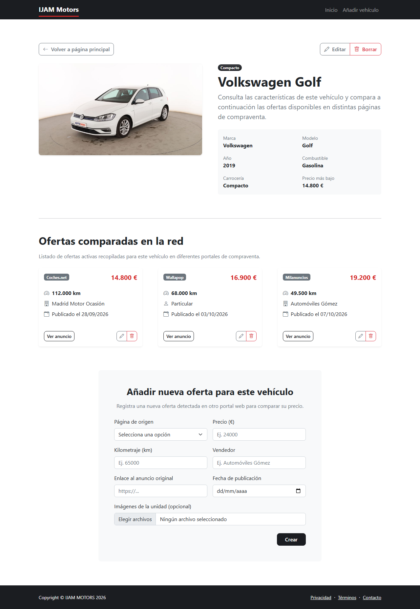
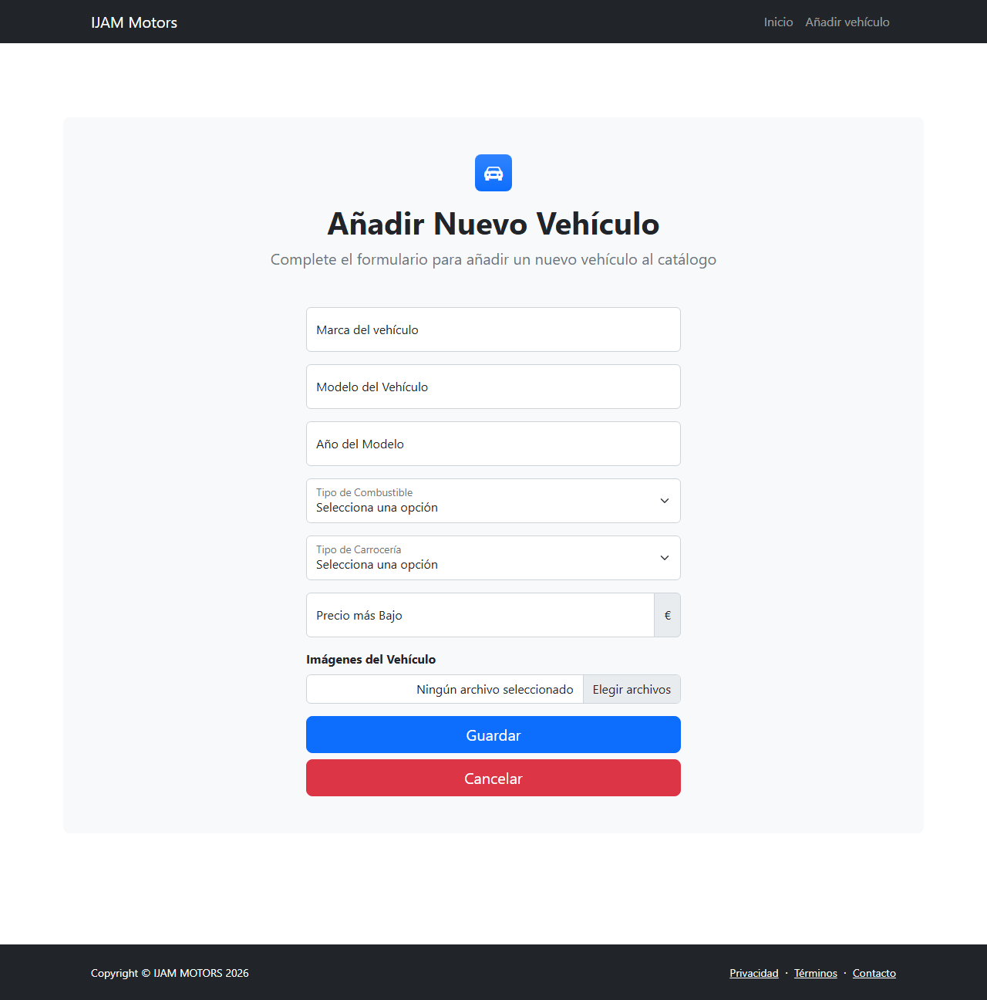

# IJAM Motors

## Descripción

**IJAM Motors** es una aplicación web que recopila en un mismo sitio vehículos de segunda mano publicados en otras páginas de compraventa. Permite consultar los vehículos, ver sus características e imágenes y comparar las ofertas de un mismo vehículo en distintas webs. La aplicación no mantiene ninguna comisión ni acuerdo con las páginas de origen. Los datos mostrados no se extraen de dichas webs, sino que son datos de ejemplo ficticios.

## Integrantes

| Nombre | Correo URJC | GitHub |
|---|---|---|
| Julián García Panadero | j.garciap.2024@alumnos.urjc.es | julianjgp23 |
| Alejandro Sánchez Aparisi* | a.sancheza.2024@alumnos.urjc.es | aleskyy7 |
| Iñigo Álvaro Sabaté | i.alvaro.2024@alumnos.urjc.es | IniAlv22 |
| Izan Calle Feijoo | i.calle.2024@alumnos.urjc.es | IzanCalle |

*\*Commits de Alejandro registrados también como `Alejandro` (`tu-correo@example.com`).*

# Funcionalidad

## Entidades

### Entidad principal: Vehículo

Representa un modelo de vehículo recopilado en la aplicación, del que pueden existir varias unidades anunciadas en páginas externas.

| Atributo | Tipo | Descripción |
|---|---|---|
| `brand` | String | Marca del vehículo. |
| `model` | String | Modelo del vehículo. |
| `year` | Number | Año del modelo. |
| `fuelType` | String | Tipo de combustible. |
| `bodyType` | String | Tipo de carrocería (SUV, berlina, compacto, coupé...). |
| `lowestPrice` | Number | Precio más bajo entre todas sus ofertas. |
| `image` | String | Imagen o imágenes del vehículo. |

### Entidad secundaria: Oferta

Representa un anuncio de una unidad concreta del vehículo en una página externa.

| Atributo | Tipo | Descripción |
|---|---|---|
| `site` | String | Página donde está publicado el anuncio. |
| `price` | Number | Precio del anuncio. |
| `kilometers` | Number | Kilometraje de esa unidad. |
| `seller` | String | Vendedor (particular o profesional). |
| `url` | String | Enlace al anuncio original. |
| `date` | Date | Fecha de publicación del anuncio. |
| `image` | String | Imagen o imágenes de la unidad anunciada (opcional). |

Cada vehículo podrá tener varias ofertas y cada oferta pertenecerá a un único vehículo.

## Imágenes

- **Vehículo:** cada vehículo tendrá asociadas una o varias imágenes de referencia del modelo, que podrán ser subidas desde el navegador.
- **Oferta:** cada oferta podrá tener opcionalmente una o varias imágenes de la unidad concreta anunciada (exterior e interior), también subidas desde el navegador.

## Buscador, filtrado y categorización

La aplicación permitirá buscar vehículos por **marca o modelo**.

También se podrán aplicar filtros según diferentes características del vehículo:

- Marca.
- Año.
- Combustible.

Y filtros según las características de sus ofertas (se mostrarán los vehículos que tengan al menos una oferta que cumpla el filtro):

- Precio.
- Kilometraje.
- Página de origen (sitio donde está anunciado el vehículo).

Los vehículos podrán categorizarse según su **tipo de carrocería**, por ejemplo:

- SUV.
- Berlina.
- Compacto.
- Coupé.

# Práctica 1: Maquetación de páginas web con HTML y CSS

En esta práctica se ha maquetado la web de **IJAM Motors** con HTML y CSS, sin servidor. Se ha partido de la plantilla *Modern Business* de Start Bootstrap (Bootstrap 5.2.3) y se ha adaptado a un agregador de vehículos de segunda mano. La web tiene tres páginas, que comparten la barra de navegación y el pie de página.

| Página | Fichero | Contenido |
|---|---|---|
| Página principal | [`index.html`](index.html) | Catálogo de vehículos en un grid, con buscador, categorías y filtros |
| Página de detalle | [`vehicle.html`](vehicle.html) | Ficha de un vehículo, sus ofertas y el formulario para crear una oferta |
| Página de nuevo elemento | [`new-vehicle.html`](new-vehicle.html) | Formulario para crear un vehículo |

## Capturas de pantalla

### Página principal

Muestra los 9 vehículos de ejemplo en un grid de 1, 2 o 3 columnas según el ancho de la pantalla. Encima del grid están el buscador por marca o modelo, las categorías por tipo de carrocería y el botón para crear un vehículo. A la izquierda hay un panel con los filtros del vehículo y de sus ofertas. Al hacer clic en una tarjeta se abre la página de detalle.



### Página de detalle

Muestra la imagen y los atributos del vehículo, con los botones para volver a la página principal, editar y borrar. Debajo aparecen las ofertas del vehículo, cada una con sus botones de editar y borrar, y el formulario para crear una oferta nueva.



### Página de nuevo elemento

Muestra el formulario para crear un vehículo, con un campo por cada atributo y la subida de imágenes. El botón Cancelar vuelve a la página principal.



## Participación de los miembros

### Julián García Panadero ([julianjgp23](https://github.com/julianjgp23))

**Tareas realizadas**

Se ha encargado de la página principal. Maquetó el grid de 9 tarjetas con las fotos y los datos de cada vehículo, y añadió el buscador por marca o modelo, las categorías por tipo de carrocería, el panel de filtros (marca, año, combustible, precio, kilometraje y página de origen) y el botón para crear un vehículo. Después convirtió el catálogo en la página principal del sitio y unificó la barra de navegación y el pie en las tres páginas. También eliminó restos de la plantilla, ajustó la página de detalle para que muestre los atributos definidos en el README, redactó la descripción inicial de la funcionalidad y preparó esta documentación.

**Commits más significativos**

1. [Grid de tarjetas de vehículos en la página principal](https://github.com/CodeURJC-FW-2026-27/webapp04/commit/2fc0b4e71a8fc583a66d0cbad2e5959af7f1e936)
2. [Buscador por marca o modelo](https://github.com/CodeURJC-FW-2026-27/webapp04/commit/bebc99c0fcbb2a709138162410e3e3bffd5c42b9)
3. [Categorías por tipo de carrocería](https://github.com/CodeURJC-FW-2026-27/webapp04/commit/64a1073ba7fd70838ed93265fb7ecdbdb4267d63)
4. [Panel lateral de filtros](https://github.com/CodeURJC-FW-2026-27/webapp04/commit/d3d3670e6f389cf46009d40a2fdab88edd9721f3)
5. [Enlaces y barra de navegación tras convertir el catálogo en la página principal](https://github.com/CodeURJC-FW-2026-27/webapp04/commit/c6118cf9da2c0473ec663e0767e8487c1da9fe19)

**Ficheros con mayor participación**

1. [`index.html`](index.html)
2. [`assets/img/`](assets/img) (fotos de los vehículos)
3. [`README.md`](README.md)
4. [`docs/practica1/`](docs/practica1) (capturas de pantalla)
5. [`vehicle.html`](vehicle.html)

### Alejandro Sánchez Aparisi ([aleskyy7](https://github.com/aleskyy7))

**Tareas realizadas**

Se ha encargado de la página de nuevo elemento. Maquetó el formulario para crear un vehículo con todos sus atributos (marca, modelo, año, combustible, carrocería, precio más bajo e imágenes), usando el tipo de campo más específico en cada caso, y los botones Guardar y Cancelar. Además actualizó la versión de Bootstrap Icons y la barra de navegación en todas las páginas, tradujo los comentarios de su página al inglés y pasó a inglés los nombres de los atributos en el README.

**Commits más significativos**

1. [Formulario para añadir un vehículo](https://github.com/CodeURJC-FW-2026-27/webapp04/commit/f952dc263dd12febaaebf82fc2772b78a84c599d)
2. [Desplegables para el combustible y la carrocería](https://github.com/CodeURJC-FW-2026-27/webapp04/commit/c2eecb839fc5a20b3bd33d83fee46decb7ad8ddc)
3. [Campo del precio con *input group*](https://github.com/CodeURJC-FW-2026-27/webapp04/commit/c8ce25a5eda245a3981cbfc3b4a83536cd9efa76)
4. [Botones Guardar y Cancelar del formulario](https://github.com/CodeURJC-FW-2026-27/webapp04/commit/ba7ba77044c4199c57ac5e865069f05d35e44b5b)
5. [Traducción de los comentarios al inglés](https://github.com/CodeURJC-FW-2026-27/webapp04/commit/abf55f4c9619b7aba428fc619bcbbb0442a1c95e)

**Ficheros con mayor participación**

1. [`new-vehicle.html`](new-vehicle.html)
2. [`index.html`](index.html)
3. [`README.md`](README.md)

### Iñigo Álvaro Sabaté ([IniAlv22](https://github.com/IniAlv22))

**Tareas realizadas**

Incorporó al repositorio la plantilla *Modern Business*, sobre la que se ha construido el sitio, y la limpió eliminando las páginas y secciones que no se iban a usar. De esa limpieza procede la estructura común de las páginas. Unificó el estilo de los formularios de creación de vehículo y de oferta (etiqueta encima de cada campo, mismo contenedor y botones alineados a la derecha) y ajustó sus campos para que coincidieran con los atributos de las entidades definidas en el README. Creó la hoja de estilos propia [`css/custom.css`](css/custom.css), que da a la web su identidad visual sin modificar la plantilla: colores de marca en la barra de navegación, el pie y los botones, mismo redondeo para todos los botones, estilo de las categorías y de los campos de los formularios, efecto al pasar el ratón por las tarjetas de vehículos y ofertas, imágenes del catálogo con la misma proporción y precios destacados. También integró la documentación de la Práctica 1 en el README (Antes era un archivo a parte).

**Commits más significativos**

1. [Hoja de estilos propia con los colores de IJAM Motors](https://github.com/CodeURJC-FW-2026-27/webapp04/commit/c9f39454d08a6569db39161938eee110c3cc2342)
2. [Unificación del estilo de los formularios y campos alineados con las entidades](https://github.com/CodeURJC-FW-2026-27/webapp04/commit/2f6e5a51bb5511dc4592f8e0f671e3ecbb477dfc)
3. [Estilo de las tarjetas de vehículos y ofertas](https://github.com/CodeURJC-FW-2026-27/webapp04/commit/c1feb14caf5b4892a29cfb94e2c187a97ab84eec)
4. [Estilo de las categorías y de los campos de los formularios](https://github.com/CodeURJC-FW-2026-27/webapp04/commit/9766b123a15502a7cead0da44afd56d659414038)
5. [Incorporación de la plantilla *Modern Business*](https://github.com/CodeURJC-FW-2026-27/webapp04/commit/22695e920a9d592d51379f96d7ed957afd165e3e)

**Ficheros con mayor participación**

1. [`css/custom.css`](css/custom.css)
2. [`new-vehicle.html`](new-vehicle.html)
3. [`vehicle.html`](vehicle.html)
4. [`index.html`](index.html)
5. [`README.md`](README.md)

### Izan Calle Feijoo ([IzanCalle](https://github.com/IzanCalle))

**Tareas realizadas**

Se ha encargado de la página de detalle. Sustituyó la página de la plantilla por la ficha del vehículo, con su imagen, sus atributos y los botones para volver a la página principal, editar y borrar. Maquetó el listado de ofertas del vehículo en tarjetas, cada una con sus botones de editar y borrar, y el formulario para crear una oferta nueva. También enlazó las tarjetas de la página principal con la página de detalle.

**Commits más significativos**

1. [Creación de la página de detalle y enlace desde la página principal](https://github.com/CodeURJC-FW-2026-27/webapp04/commit/fc888e4b62b2fc7106ded09f82794d83b7ef1f6b)
2. [Comparación de ofertas y formulario para crear una oferta](https://github.com/CodeURJC-FW-2026-27/webapp04/commit/b71ff765fa45cf99327a830e62662a8ff32f9966)
3. [Imagen del vehículo en la ficha](https://github.com/CodeURJC-FW-2026-27/webapp04/commit/7b3d20f390b828dbd09f96fbbaba15a5bfa24c75)
4. [Ajuste de los datos de ejemplo del vehículo](https://github.com/CodeURJC-FW-2026-27/webapp04/commit/e25f807ce0834a6543a79c8d2ba1a7dbc72c6a69)
5. [Eliminación de la página de detalle de la plantilla](https://github.com/CodeURJC-FW-2026-27/webapp04/commit/02007bd1936d58713ae12172f6a526b4a9e97de6)

**Ficheros con mayor participación**

1. [`vehicle.html`](vehicle.html)
2. [`index.html`](index.html)

# Práctica 2: Aplicación web del lado del servidor con Node.js

En esta práctica la web de **IJAM Motors** pasa a ser una aplicación completa con un servidor en **Node.js** y **Express**, que guarda los datos en **MongoDB** y genera las páginas con plantillas **Mustache**. Ahora se pueden listar, crear, editar y borrar vehículos y sus ofertas. Las imágenes subidas desde el navegador se guardan en la carpeta `uploads`.

Los vehículos se guardan en la colección `Vehicles` de la base de datos `ijam_motors`. Las ofertas de cada vehículo van dentro del propio documento del vehículo, en el array `offers`, y cada una tiene su propio `_id` para poder editarla o borrarla. Cada vez que se crea, edita o borra una oferta, se recalcula el precio más bajo del vehículo.

| Página | Ruta | Contenido |
|---|---|---|
| Página principal | `GET /` | Catálogo paginado (6 vehículos por página) con buscador, categorías por carrocería y filtros |
| Página de detalle | `GET /vehicle/:id` | Ficha del vehículo, sus ofertas y el formulario para crear una oferta |
| Nuevo vehículo | `GET /vehicle/new` | Formulario para crear un vehículo |
| Editar vehículo | `GET /vehicle/:id/edit` | El mismo formulario, relleno con los datos actuales del vehículo |
| Editar oferta | `GET /vehicle/:id/offers/:offerId/edit` | Formulario con los datos actuales de la oferta |
| Confirmación / error | — | Página intermedia que se muestra tras crear, editar o borrar, o cuando algún dato no es válido |

## Instrucciones de ejecución

### Requisitos

| Software | Versión | Notas |
|---|---|---|
| [Node.js](https://nodejs.org/) | 20.19.0 o superior | Es la versión mínima que exige el driver `mongodb` 7.9 (indicada en `engines` del `package.json`). Probado con Node.js 26.12.1. |
| [MongoDB Community Server](https://www.mongodb.com/try/download/community) | 4.4 o superior | Es la versión mínima que admite el driver `mongodb` 7.9. Probado con MongoDB 9.0.8. |
| [Git](https://git-scm.com/) | Cualquiera | Para descargar el repositorio. |

### Pasos

1. **Arrancar MongoDB** en `localhost:27017`. Si se instaló como servicio, ya estará en marcha. También se puede arrancar con Docker:

   ```bash
   docker run -d --name ijam-mongo -p 27017:27017 mongo
   ```

2. **Descargar el código y las dependencias:**

   ```bash
   git clone https://github.com/CodeURJC-FW-2026-27/webapp04.git
   cd webapp04
   npm install
   ```

3. **Ejecutar la aplicación:**

   ```bash
   npm start
   ```

4. **Abrir** [http://localhost:3000](http://localhost:3000) en el navegador.

La primera vez que se arranca con la base de datos vacía, se cargan 9 vehículos de ejemplo con sus ofertas desde [`data/data.json`](data/data.json) y se copian sus fotos de [`data/images/`](data/images) a `uploads/`. Si la base de datos ya tiene vehículos, se conservan los que haya. Para volver a los datos de ejemplo, basta con borrar la base de datos y arrancar de nuevo:

```bash
mongosh ijam_motors --eval "db.dropDatabase()"
```

### Configuración opcional

El puerto del servidor y la dirección de MongoDB se pueden cambiar con variables de entorno:

| Variable | Valor por defecto | Uso |
|---|---|---|
| `PORT` | `3000` | Puerto en el que escucha el servidor web |
| `MONGODB_URL` | `mongodb://localhost:27017` | Dirección del servidor de MongoDB |

```bash
# Linux / macOS
PORT=8080 MONGODB_URL=mongodb://localhost:27018 npm start
```

```powershell
# Windows (PowerShell)
$env:PORT = "8080"; $env:MONGODB_URL = "mongodb://localhost:27018"; npm start
```

Durante el desarrollo se puede usar `npm run watch`, que reinicia el servidor cada vez que cambia un fichero `.js`, `.html` o `.css` (usa `nodemon` a través de `npx`).

## Descripción de ficheros

### Servidor (`src/`)

| Fichero | Responsabilidad |
|---|---|
| [`src/app.js`](src/app.js) | Punto de entrada. Crea la aplicación Express, configura Mustache como motor de plantillas, sirve los ficheros estáticos de `public/`, lee los formularios con `body-parser`, monta el router y arranca el servidor en el puerto `PORT`. |
| [`src/router.js`](src/router.js) | Define todas las rutas de la web. Lee la búsqueda, la categoría, los filtros y la página del catálogo; valida en el servidor los formularios de vehículos y ofertas; recibe las imágenes con `multer` (solo JPG, PNG, WEBP o GIF) y sirve las imágenes guardadas. La creación y la edición de un vehículo comparten la misma función de validación y de guardado. Las páginas de confirmación y error se muestran con los helpers `renderConfirmation` y `renderError`. |
| [`src/vehicles.js`](src/vehicles.js) | Acceso a MongoDB. Se conecta a `MONGODB_URL` y reúne todas las consultas: listado paginado con el filtro de búsqueda, categoría y filtros construido en la propia consulta, conteo, detalle, alta, edición y borrado de vehículos, y alta, edición y borrado de ofertas (recalculando el precio más bajo del vehículo). |
| [`src/load_data.js`](src/load_data.js) | Carga los datos de ejemplo al arrancar si la base de datos está vacía: vacía `uploads/`, copia las fotos de ejemplo e inserta los vehículos con sus ofertas. |

### Vistas Mustache (`views/`)

| Fichero | Responsabilidad |
|---|---|
| [`views/header.html`](views/header.html) | *Partial* con la cabecera común: `<head>` con el título de cada página (`pageTitle`) y los estilos, y la barra de navegación, que marca la página actual. |
| [`views/footer.html`](views/footer.html) | *Partial* con el pie de página común y el JavaScript de Bootstrap. |
| [`views/index.html`](views/index.html) | Página principal: buscador, categorías, panel de filtros, grid de vehículos y paginación con página anterior, siguiente y la actual resaltada. Los filtros elegidos se mantienen al cambiar de página. |
| [`views/vehicle.html`](views/vehicle.html) | Página de detalle: datos e imagen del vehículo, botones de editar y borrar, ofertas con sus botones de editar y borrar, y formulario para crear una oferta. |
| [`views/new-vehicle.html`](views/new-vehicle.html) | Formulario de vehículo, reutilizado para crearlo y para editarlo (al editar aparece relleno y conserva la imagen si no se elige otra). Incluye las validaciones posibles en HTML. |
| [`views/edit-offer.html`](views/edit-offer.html) | Formulario para editar una oferta con sus datos actuales (conserva la imagen si no se elige otra). |
| [`views/message.html`](views/message.html) | Página única para confirmaciones y errores: icono, título, mensaje y botones para continuar, que indica el router. |

### Datos, estilos y configuración

| Fichero | Responsabilidad |
|---|---|
| [`data/data.json`](data/data.json) | Datos de ejemplo: 9 vehículos con sus ofertas. |
| [`data/images/`](data/images) | Fotos de los vehículos de ejemplo, que se copian a `uploads/` al cargar los datos. |
| [`public/css/custom.css`](public/css/custom.css) | Estilos propios de IJAM Motors (de la Práctica 1, con el tamaño del icono de la página de mensajes). |
| [`public/css/styles.css`](public/css/styles.css) | Estilos de la plantilla *Modern Business*, que incluyen Bootstrap. |
| [`public/assets/no-image.svg`](public/assets/no-image.svg) | Imagen genérica para los vehículos que no tienen foto. |
| [`package.json`](package.json) | Nombre del proyecto, scripts `start` y `watch`, versión mínima de Node.js y dependencias (`express`, `mustache-express`, `body-parser`, `multer` y `mongodb`). |
| [`.gitignore`](.gitignore) | Excluye del repositorio `node_modules/` y `uploads/`. |
| `uploads/` | Carpeta (no incluida en el repositorio) donde se guardan las imágenes de vehículos y ofertas. Se crea al cargar los datos de ejemplo. |

## Vídeo demostrativo

Vídeo en YouTube que muestra la funcionalidad de la web: [https://youtu.be/7r8xrBbgSL0](https://youtu.be/7r8xrBbgSL0)

## Participación de los miembros

### Julián García Panadero ([julianjgp23](https://github.com/julianjgp23))

**Tareas realizadas**

Reorganizó el proyecto con la estructura de una aplicación Express (`src/`, `views/` y `public/`), creó el `.gitignore` y el primer router, y adaptó los enlaces y las rutas de las páginas al servidor. Preparó los datos de ejemplo con sus fotos y su carga en la base de datos cuando está vacía, y la ruta que sirve las imágenes guardadas. En la página principal pasó el catálogo a la base de datos, con paginación de 6 vehículos por página, buscador por marca o modelo, categorías por carrocería y filtros por año, combustible, precio, kilometraje y página de origen, todo resuelto en la consulta a MongoDB. Implementó la edición de vehículos reutilizando el formulario y el código de creación, completó las validaciones del servidor (combustible, carrocería, año, formato de las imágenes y enlaces web en las ofertas) y eliminó código duplicado en las rutas de ofertas y de detalle.

**Commits más significativos**

1. [Carga de los datos de ejemplo cuando la base de datos está vacía](https://github.com/CodeURJC-FW-2026-27/webapp04/commit/0bfdb52c53cdd5fbe4a3d526b181416992424e7d)
2. [Paginación del catálogo en la base de datos, 6 vehículos por página](https://github.com/CodeURJC-FW-2026-27/webapp04/commit/edcb941af89c2c0cf5884161fb108a1c6fcd9bd7)
3. [Buscador por marca o modelo](https://github.com/CodeURJC-FW-2026-27/webapp04/commit/464760ca42b4c07a5cbc23a4716f93870464ff7a)
4. [Edición de vehículos reutilizando el formulario y el código de creación](https://github.com/CodeURJC-FW-2026-27/webapp04/commit/5a9f7b4c7039e2618cd157aa374c9c81d09031fb)
5. [Eliminación de código duplicado en las rutas de ofertas y de detalle](https://github.com/CodeURJC-FW-2026-27/webapp04/commit/7712e4f249ac8ff83e42423ae42ae920b07d9311)

**Ficheros con mayor participación**

1. [`src/router.js`](src/router.js)
2. [`views/index.html`](views/index.html)
3. [`data/data.json`](data/data.json)
4. [`src/vehicles.js`](src/vehicles.js)
5. [`src/load_data.js`](src/load_data.js)

### Alejandro Sánchez Aparisi ([aleskyy7](https://github.com/aleskyy7))

**Tareas realizadas**

Creó el servidor Express inicial (`app.js` y `package.json`) y se encargó de la creación de vehículos. Añadió la subida de imágenes con `multer`, el campo de descripción del formulario y el envío del formulario al servidor. Implementó las validaciones del servidor para el vehículo (campos obligatorios, marca y modelo empezando por mayúscula, descripción entre 10 y 300 caracteres, año y precio válidos) y la comprobación de vehículos duplicados. Conectó la aplicación a MongoDB con las primeras funciones de acceso a los vehículos y creó la primera página de confirmación tras crear un vehículo. También reorganizó el código de subida de imágenes y la forma de mostrar los errores del formulario.

**Commits más significativos**

1. [Servidor Express inicial (`app.js` y `package.json`)](https://github.com/CodeURJC-FW-2026-27/webapp04/commit/24b6970305faf06edb2b7197debdeb4b51d810c6)
2. [Subida de imágenes con `multer` al crear un vehículo](https://github.com/CodeURJC-FW-2026-27/webapp04/commit/b07ee1a674fe7f6845645eeb6d6b47c9805232be)
3. [Cliente de MongoDB y funciones de gestión de vehículos](https://github.com/CodeURJC-FW-2026-27/webapp04/commit/d1d8f84905cc5c0f1ce4b5f1ae6089f371895d6c)
4. [Comprobación de vehículos duplicados y página de confirmación](https://github.com/CodeURJC-FW-2026-27/webapp04/commit/f610b3ee9b2563139dd315fec832c2bef83ce4af)
5. [Validación de la descripción y de los campos numéricos](https://github.com/CodeURJC-FW-2026-27/webapp04/commit/3d2d097e408f1516c019f4078dc220b47ee4a70e)

**Ficheros con mayor participación**

1. [`src/router.js`](src/router.js)
2. [`src/app.js`](src/app.js)
3. [`views/new-vehicle.html`](views/new-vehicle.html)
4. [`package.json`](package.json)
5. [`src/vehicles.js`](src/vehicles.js)

### Iñigo Álvaro Sabaté ([IniAlv22](https://github.com/IniAlv22))

**Tareas realizadas**

Creó los *partials* de Mustache [`header.html`](views/header.html) y [`footer.html`](views/footer.html), que quitan de las vistas la cabecera, la barra de navegación y el pie que estaban repetidos en todas. Cada ruta envía el título de su página y la barra de navegación marca la página actual. Unificó las páginas de confirmación y de error, que eran casi iguales, en una sola vista [`message.html`](views/message.html), y en el router sustituyó las llamadas repetidas por los helpers `renderConfirmation` y `renderError`. Al hacerlo, la confirmación de un vehículo nuevo pasó a mostrar su marca y modelo, con botones para ver su detalle o volver al inicio. Además, el puerto del servidor y la dirección de MongoDB pasaron a leerse de las variables de entorno `PORT` y `MONGODB_URL`, y se indicó en el `package.json` la versión mínima de Node.js. Redactó también esta documentación de la Práctica 2.

**Commits más significativos**

1. [*Partials* de cabecera y pie compartidos por todas las vistas](https://github.com/CodeURJC-FW-2026-27/webapp04/commit/38798716b6ba9c9f5a466f1e486afef6c6436f79)
2. [Página única de confirmación y error](https://github.com/CodeURJC-FW-2026-27/webapp04/commit/518ba66901ec3b406768925bad0780891eaa13d1)
3. [Puerto y dirección de MongoDB leídos de variables de entorno](https://github.com/CodeURJC-FW-2026-27/webapp04/commit/53e7204cfa2d9195277c35f62410f93367ffb47b)

**Ficheros con mayor participación**

1. [`views/header.html`](views/header.html)
2. [`views/footer.html`](views/footer.html)
3. [`views/message.html`](views/message.html)
4. [`src/router.js`](src/router.js)
5. [`README.md`](README.md)

### Izan Calle Feijoo ([IzanCalle](https://github.com/IzanCalle))

**Tareas realizadas**

Se ha encargado de la página de detalle y de las ofertas. Convirtió la ficha del vehículo en una plantilla Mustache con los datos de la base de datos e implementó el borrado del vehículo. Programó las consultas de MongoDB para crear, editar y borrar ofertas dentro del vehículo, recalculando su precio más bajo, y las rutas para crearlas y borrarlas con validación en el servidor. Creó la página para editar una oferta, que conserva la imagen anterior si no se elige otra, y las primeras páginas de confirmación y de error.

**Commits más significativos**

1. [Consultas de MongoDB para borrar vehículos y gestionar ofertas](https://github.com/CodeURJC-FW-2026-27/webapp04/commit/0e9c580f635a39a69f47734a1841b0588db805ab)
2. [Página de detalle dinámica, borrado del vehículo y páginas de confirmación y error](https://github.com/CodeURJC-FW-2026-27/webapp04/commit/6a449212749b62bffeee65409c86eb6b8ad21705)
3. [Ficha del vehículo con Mustache y página de error](https://github.com/CodeURJC-FW-2026-27/webapp04/commit/ce07e874191eb1136b7564036e1722a6894a2e95)
4. [Creación y borrado de ofertas con validación en el servidor](https://github.com/CodeURJC-FW-2026-27/webapp04/commit/2122fb3e36b31f7911a712b15b2cac83541b5a58)
5. [Edición de ofertas conservando la imagen anterior](https://github.com/CodeURJC-FW-2026-27/webapp04/commit/f383a0fab99ed0ec829664136c70f9667f9de806)

**Ficheros con mayor participación**

1. [`src/router.js`](src/router.js)
2. [`views/vehicle.html`](views/vehicle.html)
3. [`views/edit-offer.html`](views/edit-offer.html)
4. [`src/vehicles.js`](src/vehicles.js)
