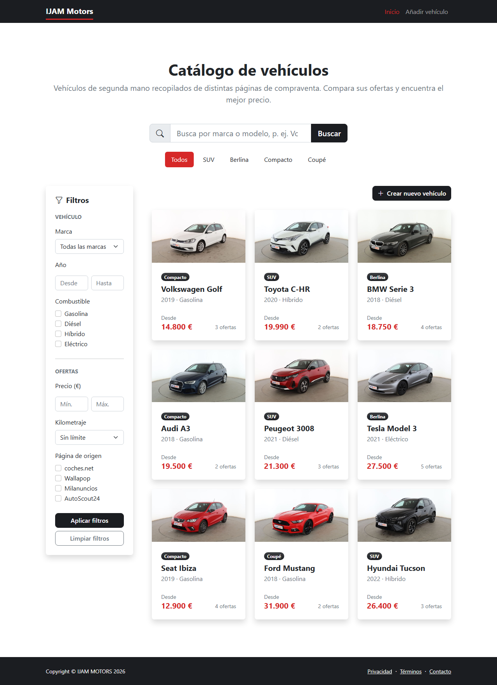
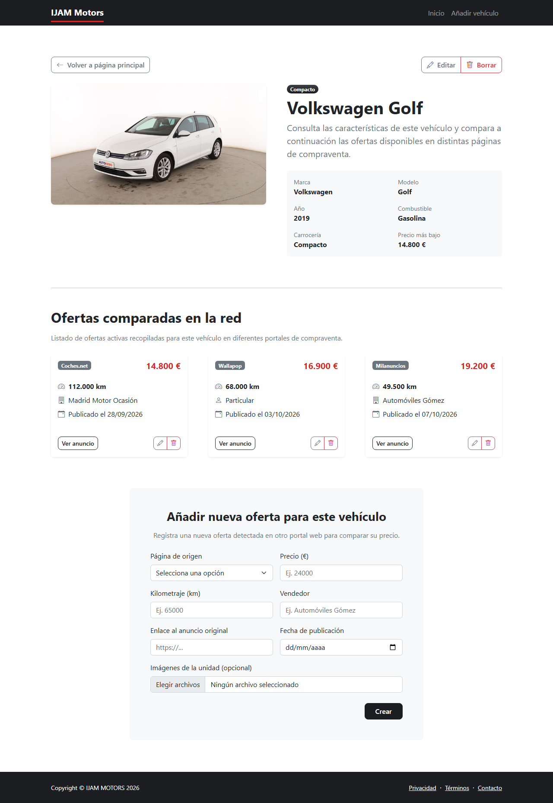
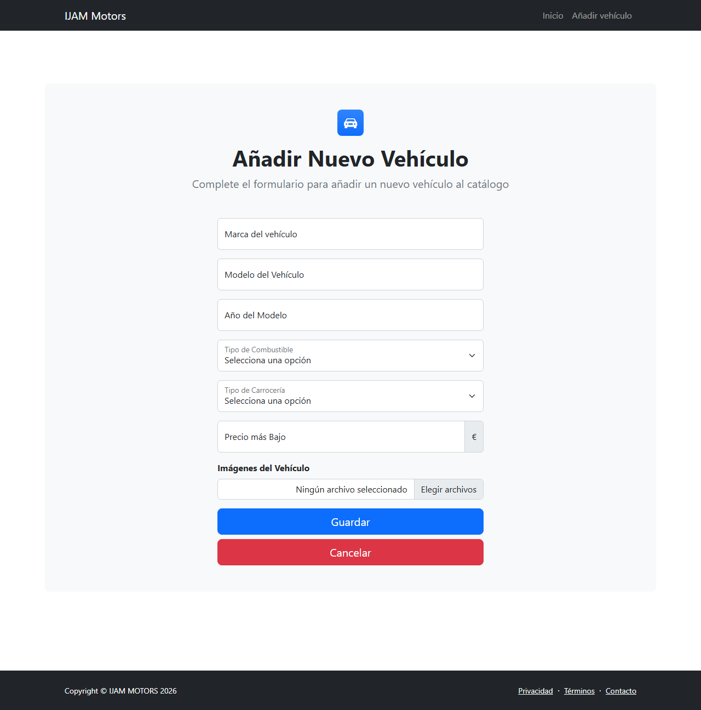

# IJAM Motors

## Descripción

**IJAM Motors** es una aplicación web que recopila en un mismo sitio vehículos de segunda mano publicados en otras páginas de compraventa. Permite consultar los vehículos, ver sus características e imágenes y comparar las ofertas de un mismo vehículo en distintas webs. La aplicación no mantiene ninguna comisión ni acuerdo con las páginas de origen. Los datos mostrados no se extraen de dichas webs, sino que son datos de ejemplo ficticios.

## Integrantes

| Nombre | Correo URJC | GitHub |
|---|---|---|
| Julián García Panadero | j.garciap.2024@alumnos.urjc.es | julianjgp23 |
| Alejandro Sánchez Aparisi* | a.sancheza.2024@alumnos.urjc.es | aleskyy7 |
| Iñigo Álvaro Sabaté | i.alvaro.2024@alumnos.urjc.es | IniAlv22 |
| Izan Calle Feijoo | i.calle.2024@alumnos.urjc.es | IzanCalle |

*\*Commits de Alejandro registrados también como `Alejandro` (`tu-correo@example.com`).*

# Funcionalidad

## Entidades

### Entidad principal: Vehículo

Representa un modelo de vehículo recopilado en la aplicación, del que pueden existir varias unidades anunciadas en páginas externas.

| Atributo | Tipo | Descripción |
|---|---|---|
| `brand` | String | Marca del vehículo. |
| `model` | String | Modelo del vehículo. |
| `year` | Number | Año del modelo. |
| `fuelType` | String | Tipo de combustible. |
| `bodyType` | String | Tipo de carrocería (SUV, berlina, compacto, coupé...). |
| `lowestPrice` | Number | Precio más bajo entre todas sus ofertas. |
| `image` | String | Imagen o imágenes del vehículo. |

### Entidad secundaria: Oferta

Representa un anuncio de una unidad concreta del vehículo en una página externa.

| Atributo | Tipo | Descripción |
|---|---|---|
| `site` | String | Página donde está publicado el anuncio. |
| `price` | Number | Precio del anuncio. |
| `kilometers` | Number | Kilometraje de esa unidad. |
| `seller` | String | Vendedor (particular o profesional). |
| `url` | String | Enlace al anuncio original. |
| `date` | Date | Fecha de publicación del anuncio. |
| `image` | String | Imagen o imágenes de la unidad anunciada (opcional). |

Cada vehículo podrá tener varias ofertas y cada oferta pertenecerá a un único vehículo.

## Imágenes

- **Vehículo:** cada vehículo tendrá asociadas una o varias imágenes de referencia del modelo, que podrán ser subidas desde el navegador.
- **Oferta:** cada oferta podrá tener opcionalmente una o varias imágenes de la unidad concreta anunciada (exterior e interior), también subidas desde el navegador.

## Buscador, filtrado y categorización

La aplicación permitirá buscar vehículos por **marca o modelo**.

También se podrán aplicar filtros según diferentes características del vehículo:

- Marca.
- Año.
- Combustible.

Y filtros según las características de sus ofertas (se mostrarán los vehículos que tengan al menos una oferta que cumpla el filtro):

- Precio.
- Kilometraje.
- Página de origen (sitio donde está anunciado el vehículo).

Los vehículos podrán categorizarse según su **tipo de carrocería**, por ejemplo:

- SUV.
- Berlina.
- Compacto.
- Coupé.

# Práctica 1: Maquetación de páginas web con HTML y CSS

En esta práctica se ha maquetado la web de **IJAM Motors** con HTML y CSS, sin servidor. Se ha partido de la plantilla *Modern Business* de Start Bootstrap (Bootstrap 5.2.3) y se ha adaptado a un agregador de vehículos de segunda mano. La web tiene tres páginas, que comparten la barra de navegación y el pie de página.

| Página | Fichero | Contenido |
|---|---|---|
| Página principal | [`index.html`](index.html) | Catálogo de vehículos en un grid, con buscador, categorías y filtros |
| Página de detalle | [`vehicle.html`](vehicle.html) | Ficha de un vehículo, sus ofertas y el formulario para crear una oferta |
| Página de nuevo elemento | [`new-vehicle.html`](new-vehicle.html) | Formulario para crear un vehículo |

## Capturas de pantalla

### Página principal

Muestra los 9 vehículos de ejemplo en un grid de 1, 2 o 3 columnas según el ancho de la pantalla. Encima del grid están el buscador por marca o modelo, las categorías por tipo de carrocería y el botón para crear un vehículo. A la izquierda hay un panel con los filtros del vehículo y de sus ofertas. Al hacer clic en una tarjeta se abre la página de detalle.

### Página de detalle

Muestra la imagen y los atributos del vehículo, con los botones para volver a la página principal, editar y borrar. Debajo aparecen las ofertas del vehículo, cada una con sus botones de editar y borrar, y el formulario para crear una oferta nueva.

### Página de nuevo elemento

Muestra el formulario para crear un vehículo, con un campo por cada atributo y la subida de imágenes. El botón Cancelar vuelve a la página principal.

## Participación de los miembros

### Julián García Panadero ([julianjgp23](https://github.com/julianjgp23))

**Tareas realizadas**

Se ha encargado de la página principal. Maquetó el grid de 9 tarjetas con las fotos y los datos de cada vehículo, y añadió el buscador por marca o modelo, las categorías por tipo de carrocería, el panel de filtros (marca, año, combustible, precio, kilometraje y página de origen) y el botón para crear un vehículo. Después convirtió el catálogo en la página principal del sitio y unificó la barra de navegación y el pie en las tres páginas. También eliminó restos de la plantilla, ajustó la página de detalle para que muestre los atributos definidos en el README, redactó la descripción inicial de la funcionalidad y preparó esta documentación.

**Commits más significativos**

1. [Grid de tarjetas de vehículos en la página principal](https://github.com/CodeURJC-FW-2026-27/webapp04/commit/2fc0b4e71a8fc583a66d0cbad2e5959af7f1e936)
2. [Buscador por marca o modelo](https://github.com/CodeURJC-FW-2026-27/webapp04/commit/bebc99c0fcbb2a709138162410e3e3bffd5c42b9)
3. [Categorías por tipo de carrocería](https://github.com/CodeURJC-FW-2026-27/webapp04/commit/64a1073ba7fd70838ed93265fb7ecdbdb4267d63)
4. [Panel lateral de filtros](https://github.com/CodeURJC-FW-2026-27/webapp04/commit/d3d3670e6f389cf46009d40a2fdab88edd9721f3)
5. [Enlaces y barra de navegación tras convertir el catálogo en la página principal](https://github.com/CodeURJC-FW-2026-27/webapp04/commit/c6118cf9da2c0473ec663e0767e8487c1da9fe19)

**Ficheros con mayor participación**

1. [`index.html`](index.html)
2. [`assets/img/`](assets/img) (fotos de los vehículos)
3. [`README.md`](README.md)
4. [`docs/practica1/`](docs/practica1) (capturas de pantalla)
5. [`vehicle.html`](vehicle.html)

### Alejandro Sánchez Aparisi ([aleskyy7](https://github.com/aleskyy7))

**Tareas realizadas**

Se ha encargado de la página de nuevo elemento. Maquetó el formulario para crear un vehículo con todos sus atributos (marca, modelo, año, combustible, carrocería, precio más bajo e imágenes), usando el tipo de campo más específico en cada caso, y los botones Guardar y Cancelar. Además actualizó la versión de Bootstrap Icons y la barra de navegación en todas las páginas, tradujo los comentarios de su página al inglés y pasó a inglés los nombres de los atributos en el README.

**Commits más significativos**

1. [Formulario para añadir un vehículo](https://github.com/CodeURJC-FW-2026-27/webapp04/commit/f952dc263dd12febaaebf82fc2772b78a84c599d)
2. [Desplegables para el combustible y la carrocería](https://github.com/CodeURJC-FW-2026-27/webapp04/commit/c2eecb839fc5a20b3bd33d83fee46decb7ad8ddc)
3. [Campo del precio con *input group*](https://github.com/CodeURJC-FW-2026-27/webapp04/commit/c8ce25a5eda245a3981cbfc3b4a83536cd9efa76)
4. [Botones Guardar y Cancelar del formulario](https://github.com/CodeURJC-FW-2026-27/webapp04/commit/ba7ba77044c4199c57ac5e865069f05d35e44b5b)
5. [Traducción de los comentarios al inglés](https://github.com/CodeURJC-FW-2026-27/webapp04/commit/abf55f4c9619b7aba428fc619bcbbb0442a1c95e)

**Ficheros con mayor participación**

1. [`new-vehicle.html`](new-vehicle.html)
2. [`index.html`](index.html)
3. [`README.md`](README.md)

### Iñigo Álvaro Sabaté ([IniAlv22](https://github.com/IniAlv22))

**Tareas realizadas**

Incorporó al repositorio la plantilla *Modern Business*, sobre la que se ha construido el sitio, y la limpió eliminando las páginas y secciones que no se iban a usar. De esa limpieza procede la estructura común de las páginas. Unificó el estilo de los formularios de creación de vehículo y de oferta (etiqueta encima de cada campo, mismo contenedor y botones alineados a la derecha) y ajustó sus campos para que coincidieran con los atributos de las entidades definidas en el README. Creó la hoja de estilos propia [`css/custom.css`](css/custom.css), que da a la web su identidad visual sin modificar la plantilla: colores de marca en la barra de navegación, el pie y los botones, mismo redondeo para todos los botones, estilo de las categorías y de los campos de los formularios, efecto al pasar el ratón por las tarjetas de vehículos y ofertas, imágenes del catálogo con la misma proporción y precios destacados. También integró la documentación de la Práctica 1 en el README (Antes era un archivo a parte).

**Commits más significativos**

1. [Hoja de estilos propia con los colores de IJAM Motors](https://github.com/CodeURJC-FW-2026-27/webapp04/commit/c9f39454d08a6569db39161938eee110c3cc2342)
2. [Unificación del estilo de los formularios y campos alineados con las entidades](https://github.com/CodeURJC-FW-2026-27/webapp04/commit/2f6e5a51bb5511dc4592f8e0f671e3ecbb477dfc)
3. [Estilo de las tarjetas de vehículos y ofertas](https://github.com/CodeURJC-FW-2026-27/webapp04/commit/c1feb14caf5b4892a29cfb94e2c187a97ab84eec)
4. [Estilo de las categorías y de los campos de los formularios](https://github.com/CodeURJC-FW-2026-27/webapp04/commit/9766b123a15502a7cead0da44afd56d659414038)
5. [Incorporación de la plantilla *Modern Business*](https://github.com/CodeURJC-FW-2026-27/webapp04/commit/22695e920a9d592d51379f96d7ed957afd165e3e)

**Ficheros con mayor participación**

1. [`css/custom.css`](css/custom.css)
2. [`new-vehicle.html`](new-vehicle.html)
3. [`vehicle.html`](vehicle.html)
4. [`index.html`](index.html)
5. [`README.md`](README.md)

### Izan Calle Feijoo ([IzanCalle](https://github.com/IzanCalle))

**Tareas realizadas**

Se ha encargado de la página de detalle. Sustituyó la página de la plantilla por la ficha del vehículo, con su imagen, sus atributos y los botones para volver a la página principal, editar y borrar. Maquetó el listado de ofertas del vehículo en tarjetas, cada una con sus botones de editar y borrar, y el formulario para crear una oferta nueva. También enlazó las tarjetas de la página principal con la página de detalle.

**Commits más significativos**

1. [Creación de la página de detalle y enlace desde la página principal](https://github.com/CodeURJC-FW-2026-27/webapp04/commit/fc888e4b62b2fc7106ded09f82794d83b7ef1f6b)
2. [Comparación de ofertas y formulario para crear una oferta](https://github.com/CodeURJC-FW-2026-27/webapp04/commit/b71ff765fa45cf99327a830e62662a8ff32f9966)
3. [Imagen del vehículo en la ficha](https://github.com/CodeURJC-FW-2026-27/webapp04/commit/7b3d20f390b828dbd09f96fbbaba15a5bfa24c75)
4. [Ajuste de los datos de ejemplo del vehículo](https://github.com/CodeURJC-FW-2026-27/webapp04/commit/e25f807ce0834a6543a79c8d2ba1a7dbc72c6a69)
5. [Eliminación de la página de detalle de la plantilla](https://github.com/CodeURJC-FW-2026-27/webapp04/commit/02007bd1936d58713ae12172f6a526b4a9e97de6)

**Ficheros con mayor participación**

1. [`vehicle.html`](vehicle.html)
2. [`index.html`](index.html)
